<p align="center">
  <picture>
    <source media="(prefers-color-scheme: dark)" srcset="docs/assets/logo/logo-wordmark-dark.svg">
    
  </picture>
</p>

<p align="center"><em>Live-rendered, animated scientific presentations in Julia, on top of Makie.</em></p>

A Lantern talk is Julia code. Each slide declares its shapes, Typst equations and Makie plots,
and a list of *beats*, the steps you advance with a clicker. Slides are rendered live at the
resolution of whatever projector you are given, not played back as a video. Every animated
value is a pure function of the slide's playhead, so you can jump anywhere, step back and
replay, and the same deck exports deterministically to a vector PDF (one page per click), PNGs
or video.

<p align="center">
  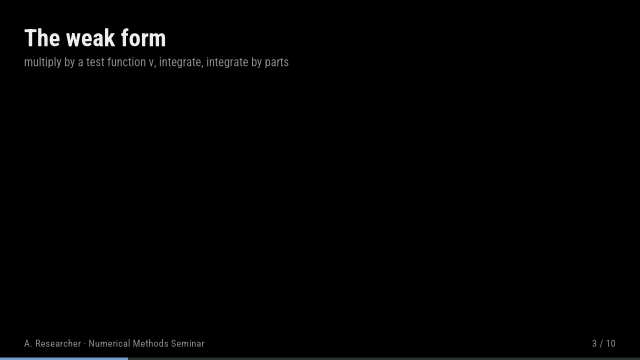
  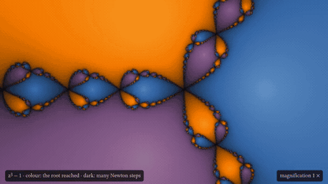
</p>

> **Status:** pre-release (0.1.0-DEV), not registered. The API may still change.

## Features

- **Beats and verbs.** `@beat` blocks collect `fadein`, `move`, `rotate`, `scale`, `recolor`,
  `create`, `morph`, … into a timeline; `seq`, `par`, `stagger` and `delay` arrange them, with
  easing curves, `auto` beats, speaker notes, and loops that keep running while a beat is held.
- **Equations.** `math!(s, typst"…")` lays out Typst math as glyph outlines; no TeX or Typst
  installation needed. Tag parts with `#tag("name", $…$)`, address them as `eq[:name]`, and
  `morph` one expression into the next: matched glyphs travel, the rest fades.
- **Live plots.** `param!` declares animatable values, `derived` computes from them, and `axis!`
  (2D and 3D) and `makie!` run ordinary Makie code, so any Makie plot can be animated, including
  the output of a solver that runs every frame.
- **Interactivity.** `slider!`, `choice!`, `toggle!` and `button!` drive plots during the talk.
- **Shapes and text.** Circles, rectangles, paths (also from SVG path data), lines, arrows,
  labels, code, pictures, and Typst text blocks and bullet lists revealed item by item.
- **Layouts and themes.** Title, content, section and blank layouts or your own; content is
  placed in body coordinates, so a layout never breaks a slide. Dark and light colour themes
  from the Tango palette, font themes and plot themes, per deck or per slide.
- **Presenting.** A GLMakie window (fullscreen, any monitor) or a web browser via WGLMakie; a
  presenter view with notes, the next state and a timer; clickers work out of the box. Decks
  reload in place when their script is saved, and a timeline window shows what every beat does.
- **Export.** `export_pdf` (vector, one page per click), `export_png` and `export_video`, all
  without a GPU via CairoMakie.

## A look at the talks

Stills and animations from the two talks in [`examples/gallery`](examples/README.md), exported with
`export_png` and `export_video`. Left to right: element-by-element assembly filling the
stiffness matrix; 336 starting points flowing to the roots of z³ − 1 under Newton's method;
the basins of three roots on loops, recomputed for every frame.

<p align="center">
  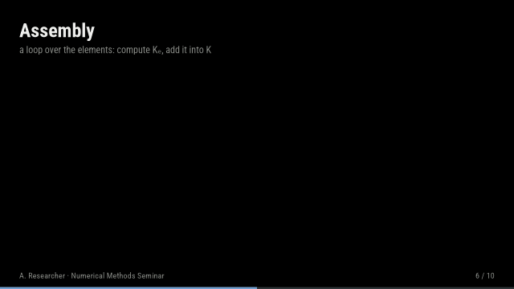
  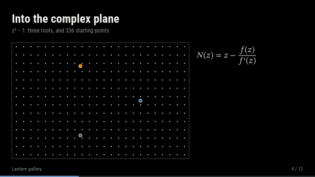
  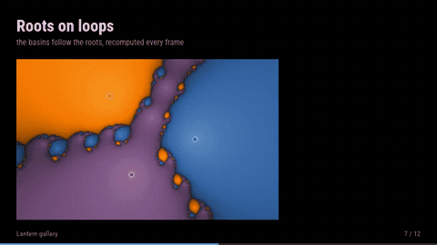
</p>

<p align="center">
  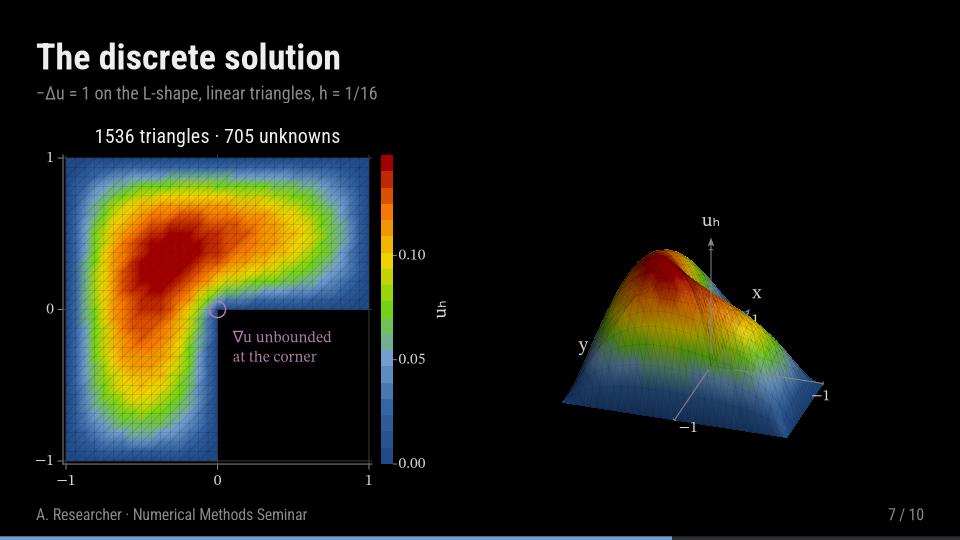
  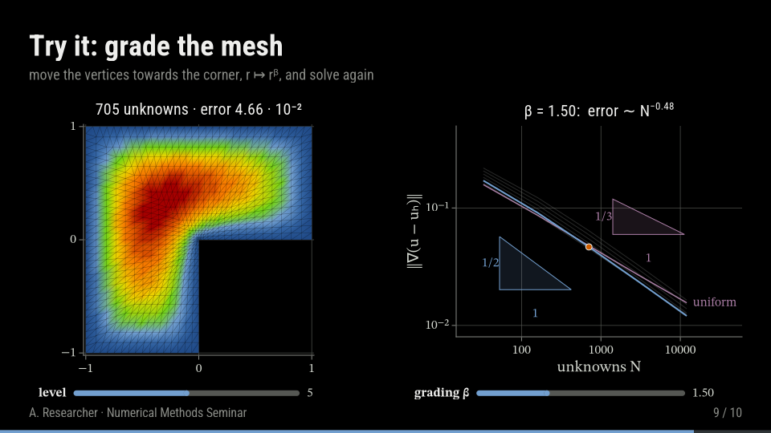
  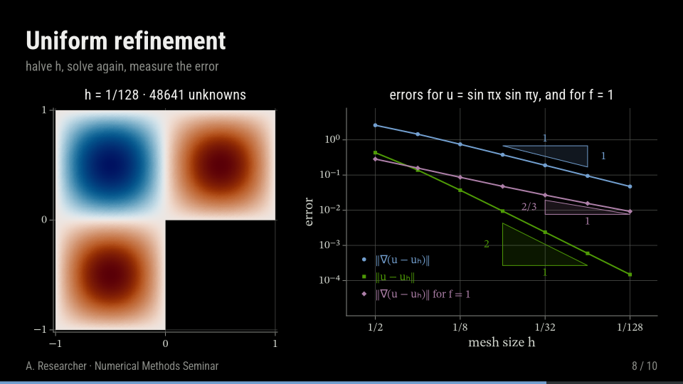
  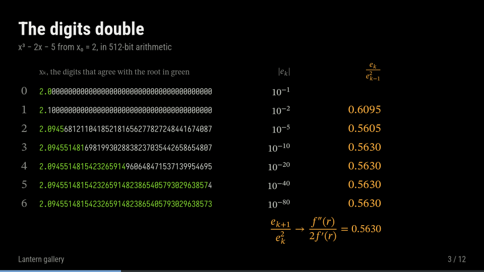
  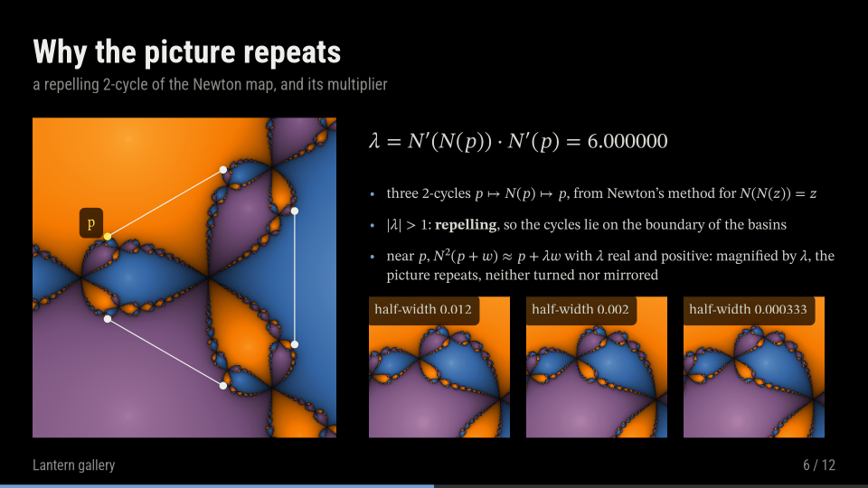
  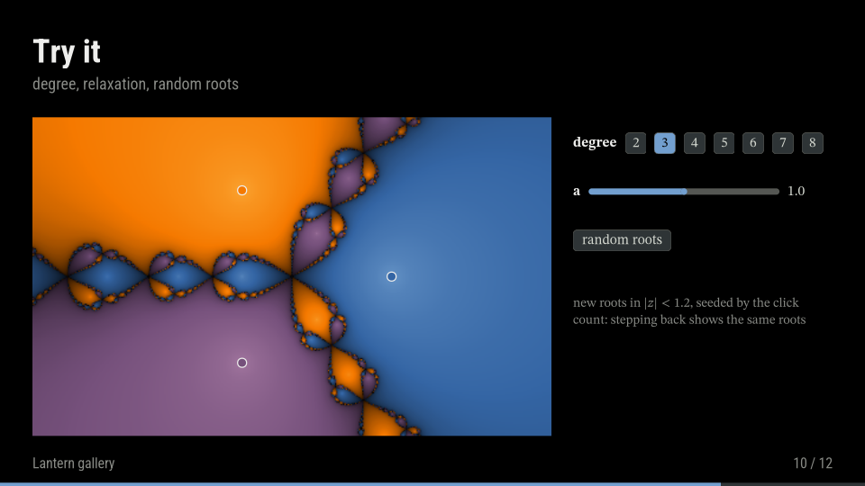
</p>

## Installation

Lantern needs Julia 1.12 or newer and is not registered yet. Add it together with the Makie
backends you want:

```
pkg> add https://github.com/schmaeke/Lantern.jl
pkg> add GLMakie CairoMakie     # GLMakie: presenting; CairoMakie: PDF, PNG and video export
pkg> add WGLMakie               # optional: presenting in a web browser
```

Lantern loads its support for a backend when you load the backend. With Homebrew's Julia on
macOS, Makie needs a library path; see the [installation notes](docs/src/index.md#installation).

## Quick start

```julia
using Lantern

deck = Deck(title = "Fourier series", author = "A. Researcher", venue = "Seminar")

slide!(deck; layout = TitleLayout(), subtitle = "A first Lantern deck")

slide!(deck; title = "Partial sums") do s
    c = circle!(s; position = (-4, 0), radius = 1.2, visible = false)
    eq = math!(s, typst"""f(x) = #tag("sum", $sum_(n=1)^oo b_n sin(n x)$)""";
        position = (2, 0), fontsize = 0.6, visible = false)
    @beat s begin                                   # beat 1: one after the other
        fadein(c, 0.5)
        create(eq)                                  # write the equation glyph by glyph
    end
    @beat s notes = "Truncate the series." begin    # beat 2: three changes together
        par(move(c, 0.8; by = (0, 1.5)),
            recolor(c, 0.8; color = s.theme.palette.orange),
            morph(eq, typst"""f(x) approx #tag("sum", $sum_(n=1)^N b_n sin(n x)$)""", 1.0))
    end
end

using GLMakie
present(deck)                    # → next beat, ← back, F fullscreen, Esc quit

using CairoMakie
export_pdf(deck, "talk.pdf")     # 3 pages: the title and the two beats
```

`present("talk.jl"; watch = true)` presents a script and rebuilds the deck, at the same slide
and beat, whenever the file is saved. In a script run with `julia talk.jl`, pass `wait = true`
so that Julia waits for the window.

## Examples

[`examples/`](examples/README.md) holds eight tutorials, one topic each, and two complete
talks:

- [The finite element method in ten minutes](examples/gallery/fem_in_ten_minutes.jl): the weak
  form and Galerkin's method as equation morphs, hat functions, element-by-element assembly, a
  turning 3D solution, measured convergence rates, and a live solve on a graded mesh.
- [Newton fractals](examples/gallery/newton_fractals.jl): tangent steps, digits doubling,
  basins recomputed every frame during an endless self-similar zoom, roots on loops, relaxed
  Newton, and a playground of widgets.

```sh
julia --project=examples -e 'using Pkg; Pkg.instantiate()'                # once
julia --project=examples examples/gallery/newton_fractals.jl --presenter  # present
julia --project=examples examples/gallery/newton_fractals.jl              # export PDF
```

## Presenting

```julia
present(deck; fullscreen = true, monitor = 2, presenter = true, duration = 20)
present(deck; backend = WGLMakieBackend())          # after `using WGLMakie`: in a browser
```

| key | action |
|---|---|
| → · PageDown · Space · click | next beat (while a beat plays: finish it) |
| ← · PageUp · right click | previous beat |
| ↓ · ↑ | next · previous slide |
| digits, then Enter | go to slide N |
| R · P · L | restart the beat · pause it · pause the loops |
| T · F · Esc | timeline window · fullscreen · quit |

The presenter view shows the current slide, the next state, the speaker notes, a timer and the
clock. While you write a slide, the timeline window shows when each statement of its beats runs
and on what; it follows the presentation, and a click shows any moment of the slide.

<p align="center">
  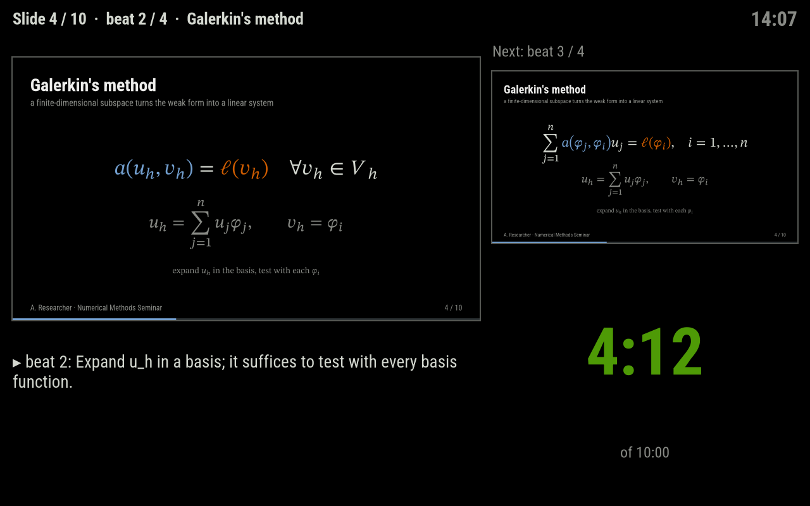
</p>
<p align="center">
  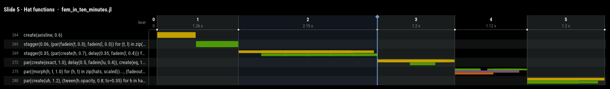
</p>

## Documentation

The manual covers concepts, authoring, every kind of scene object, presenting, export and
extending Lantern. Build it locally (no GPU needed) and open `docs/build/index.html`:

```sh
julia --project=docs -e 'using Pkg; Pkg.instantiate()'    # once
julia --project=docs docs/make.jl
```

Its pages also read well on GitHub: start with [Concepts](docs/src/manual/concepts.md) and
[Authoring](docs/src/manual/authoring.md).

## Acknowledgements

Lantern stands on [Makie.jl](https://github.com/MakieOrg/Makie.jl), which does all rendering,
and [Typst](https://typst.app), which lays out every equation. Its ideas come from
[manim](https://www.manim.community) (animation vocabulary, matching-based equation
transforms), [Motion Canvas](https://github.com/motion-canvas/motion-canvas) (authoring
ergonomics), Beamer (layouts), reveal.js and pdfpc (presenter conventions), and
[Javis.jl](https://github.com/JuliaAnimators/Javis.jl).

*Named after the magic lantern, the projector that illustrated lectures long before slides
existed.*

## License

MIT, see [LICENSE](LICENSE).
